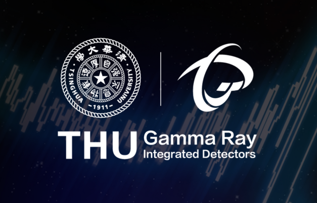
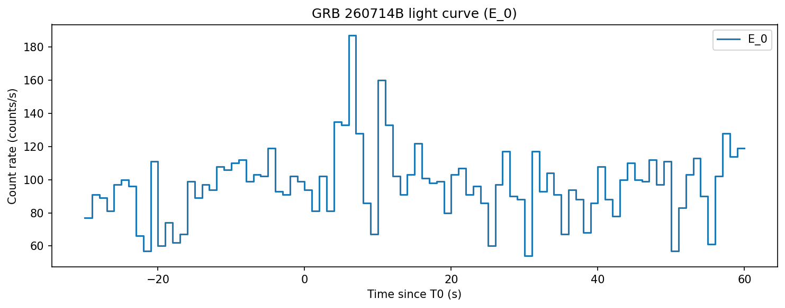
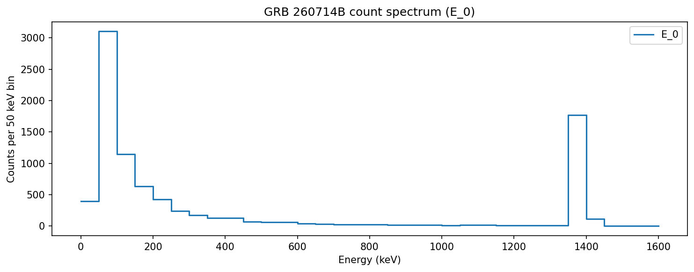

# Qsinghua-Grid

## 天格计划

“天格计划”，全称“空间分布式伽马射线暴探测网”（Gamma Ray Integrated Detectors, GRID），由清华大学在2016年发起，是一个以**本科生学生团队**为主体的空间科学项目，也是一个**理工学科交叉**的基础科学人才培养项目。

“天格计划”以寻找与引力波、快速射电暴成协的伽马暴及其他高能天体物理瞬变源为主要科学目标。为实现观测目标，团队利用微纳卫星搭载小型探测器载荷，多颗卫星组网，实现全天区、全时段的空间伽马射线监测。

截至2026年9月，**“天格计划”清华大学、南京大学、四川大学、北京师范大学**四校的学生团队设计研制和成功发射了从GRID-01到GRID-13B以及MASS-Cube卫星载荷共14颗卫星载荷。这些载荷已经观测到数十个伽马暴事例，最新的观测成果在伽马射线暴协同观测网（GCN）向全球科学界实时发布。其中MASS-Cube卫星载荷是新一代“天格计划 2.0：MeV 伽马探测纳卫星星座（MASS 核天体物理谱线巡天）”的首个纳卫星技术验证载荷项目由清华大学牵头，得到“清华大学2030创新行动计划”重大项目支持，由工物系携手中国科学院高能物理研究所、星测未来等单位共同实施，致力构建我国自主的 MeV 能区空间观测平台，推动我国在国际前沿科学领域取得原创突破。

目前“天格计划”合作组已有清华大学、南京大学、四川大学、北京师范大学、河北师范大学、中科院高能所、中科院空间科学中心等**20余所高校和研究所**共同参与合作，首批科学数据已汇交国家空间科学数据中心对科学界开放共享。

后续的卫星载荷，正期待你的参与；大量的科学数据，也等着你去发掘。从新一代载荷的设计与测试、前往观看卫星发射的实况，到编写指令控制太空中的卫星，对卫星的观测数据进行处理分析并定位伽马暴……还有无限新的创新与可能等待你的提出！

## 本仓库：GRB 260714B 事件分析作业

本仓库使用天格 GRID11B 对 GRB 260714B 的教学化事件数据。Notebook 使用 pandas 清洗事件表、DuckDB 去重和排序、NumPy 分箱，并用 Matplotlib 绘制 E_0 探测器的光变曲线与计数能谱。

清洗并去重后共 **8,704** 条 E_0 事件。时间范围为 `[-30, 60)` 秒，1 秒一箱；能量范围为 `(0, 1600]` keV，50 keV 一箱。两个分箱结果的计数总和均为 8,704。

### 光变曲线

### 计数能谱

## 文件与运行

- `python_data_duckdb_pandas_matplotlib_fits_completed.ipynb`：已填写并运行的作业 Notebook
- `GRID11B_GRB260714B_events_homework.csv`：原始事件数据
- `light_curve.png`：光变曲线
- `count_spectrum.png`：计数能谱
- `grid_cover.png`：README 封面

将 Notebook 与 CSV 保持在同一目录，在 JupyterLab、Jupyter Notebook 或 VS Code 中打开 Notebook，按顺序运行单元格。首次运行时可执行开头的依赖安装单元格。需要 Python，以及 NumPy、pandas、DuckDB 和 Matplotlib。

图中的计数能谱是各能量箱的事件数分布，未做背景扣除或仪器响应校正。
