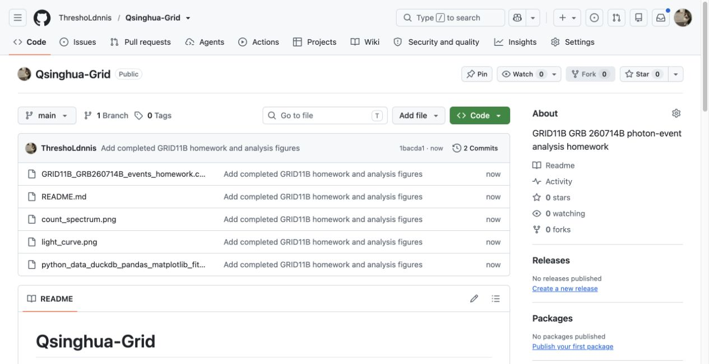

# Qsinghua-Grid

天格 GRID11B 对 GRB 260714B 的事件数据分析作业。Notebook 使用 pandas 清洗事件表、DuckDB 去重和排序、NumPy 分箱，并用 Matplotlib 绘制 E_0 探测器的光变曲线与计数能谱。

## 结果

清洗并去重后共 **8,704** 条 E_0 事件。时间范围为 `[-30, 60)` 秒，1 秒一箱；能量范围为 `(0, 1600]` keV，50 keV 一箱。两个分箱结果的计数总和均为 8,704。

### 光变曲线

### 计数能谱

## 文件

- `python_data_duckdb_pandas_matplotlib_fits_completed.ipynb`：已填写并运行的作业 Notebook
- `GRID11B_GRB260714B_events_homework.csv`：原始事件数据
- `light_curve.png`：光变曲线
- `count_spectrum.png`：计数能谱
- `github_cover.jpg`：仓库主页截图，作为 README 封面

## 运行

将 Notebook 与 CSV 保持在同一目录，在 JupyterLab、Jupyter Notebook 或 VS Code 中打开 Notebook，按顺序运行单元格。首次运行时可执行开头的依赖安装单元格。需要 Python，以及 NumPy、pandas、DuckDB 和 Matplotlib。

图中的计数能谱是各能量箱的事件数分布，未做背景扣除或仪器响应校正。
